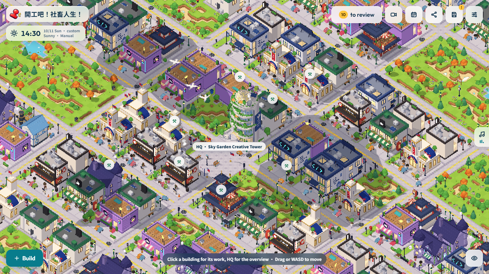
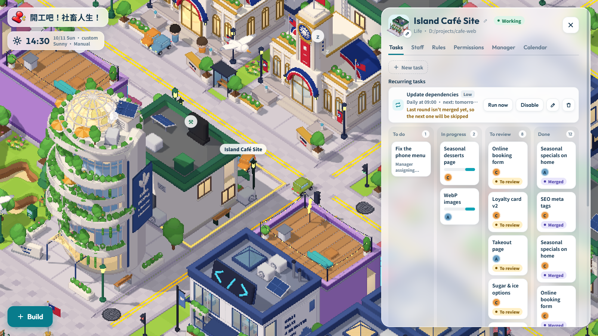
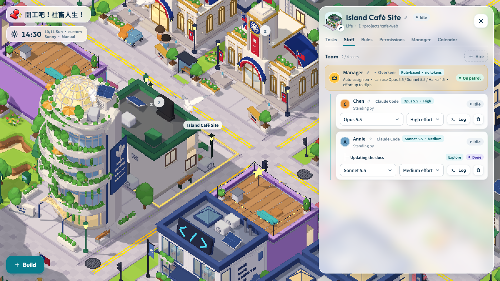
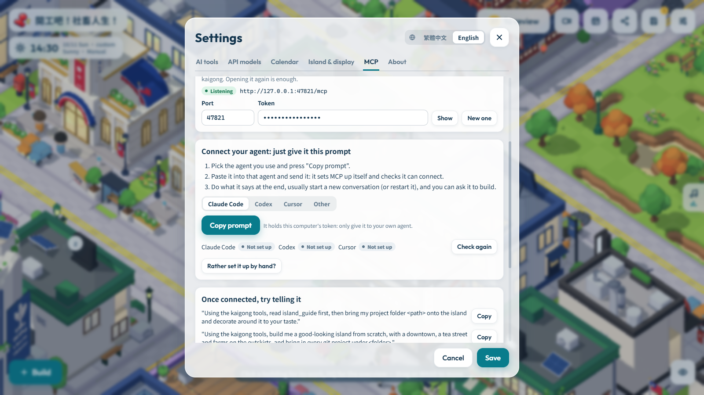

  

  <b>Turn AI coding into a little pixel island that goes to work by itself.</b> 
  Every building is a project, every employee is an AI coding agent, a manager hands out the work, and you just sign off.

  <a href="README.md">繁體中文</a> · <b>English</b>

  <a href="https://github.com/tackcrypto1031/kaigong-agent/releases/latest"><b>⬇ Download the latest version</b></a>
  ·
  <a href="#download-and-install">Install</a>
  ·
  <a href="#how-to-play">How to play</a>

## What is it

**開工吧！社畜人生！** (*Kaigong! Salaryman Life*) is a desktop app for Windows and macOS that runs your AI coding agents like a city-builder:

- **One building = one project**: attach a git project folder from your computer to a building, or start a new one from scratch.
- **One employee = one agent**: hire Claude Code, Codex CLI, or API models such as DeepSeek, Kimi and Gemini. Each employee codes on their own git branch and worktree, so nobody steps on anyone else's toes.
- **A manager hands out the work**: drop tasks on the task board and the manager gives them to whoever is free. Finished work lands in *To review*, and nothing reaches your project until you press merge.
- **Just leave it open**: employees drive to work and back, there's a clock, weather, background music and a drifting camera. It's made to sit on a second screen.

The app speaks English and Traditional Chinese (switch in Settings).

## Download and install

Get it from [Releases](https://github.com/tackcrypto1031/kaigong-agent/releases/latest):

| System | File |
|---|---|
| Windows (installer, updates itself) | `agent-factory-<version>-setup.exe` |
| Windows (no install) | `agent-factory-<version>-win-x64.zip` |
| Mac (Apple Silicon) | `agent-factory-<version>-mac-arm64.dmg` |
| Mac (Intel) | `agent-factory-<version>-mac-x64.dmg` |

- **Windows**: if SmartScreen warns you the first time, choose *More info → Run anyway*.
- **Mac**: the app isn't signed by Apple, so the first time go to *System Settings → Privacy & Security* and press *Open Anyway*.
- **You need**: at least one AI tool, e.g. a signed-in Claude Code or Codex CLI, or an API key entered in Settings. No git on your computer? No problem, the app brings its own.
- **Updates**: the Windows installer version updates itself from inside the app; the no-install zip and the Mac version tell you there's a new version and link to the download page. Your saves live in your user folder, so updating or reinstalling never loses them.

## How to play

| Action | How |
|---|---|
| Move the view | Drag with the left button, or WASD / arrow keys |
| Zoom | Mouse wheel |
| Turn the view | Drag with the right button |
| Build mode | *Build* at the bottom left, or `B` |
| Rotate what you're placing | `R` |
| See how a building is doing | Click it |
| All projects, reviews and usage | Click the HQ tower in the middle |
| Hide the interface (idle mode) | The eye button at the bottom right; `Esc` brings it back |

### 1. Build, and bring in a project

Press *Build*, pick a building and put it down, then choose your project folder (or start a new one). Lay a **stone road** from the building's front door to HQ's front door, or the employees can't drive in to work.

### 2. Hand out tasks, then review

Click a building to open its *Tasks* board and add tasks; the manager assigns them by itself. A task goes *To do → In progress → To review*, and only gets into your project once you've looked at the result and merged it. If it clashes, it goes back to the employee to sort out. Tasks can also repeat daily or weekly.

### 3. Manage your staff

On the *Staff* tab you hire employees, pick each one's model and effort, and see what they're working on, the helpers they've sent off, and their logs. Risky commands stop and wait for your stamp under *Approvals*.

### 4. Let your own agent build the island (MCP)

Prefer your own Claude Code, Codex or Cursor? Go to *Settings → MCP*, pick your agent, press *Copy prompt* and paste it to the agent: it connects itself. From then on it can read the island's rules and style guide, build, lay roads, decorate, and bring your projects onto the island.

And when you code outside the island with Claude Code or Codex as usual, the app notices which project they're working on and sends visitors driving over to that building. While they work there, the island's own employees step aside so nobody edits the same code.

## Team

**Lead developer**

[@tackcrypto1031](https://github.com/tackcrypto1031)

**Contributors**

[@jajajajaja15](https://github.com/jajajajaja15) · [@yanun0323](https://github.com/yanun0323)

Thanks to everyone who helps make the island better!
