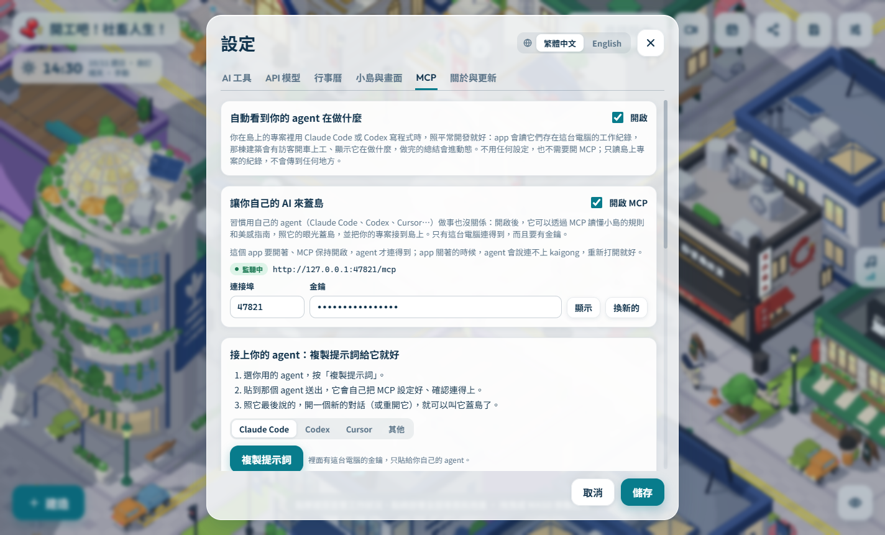

  

  <b>把 AI 寫程式這件事，變成一座會自己上班的像素小島。</b> 
  每棟建築是一個專案，每個員工是一個 AI coding agent，主管自動派工，你只要驗收。

  <b>繁體中文</b> · <a href="README.en.md">English</a>

  <a href="https://github.com/tackcrypto1031/kaigong-agent/releases/latest"><b>⬇ 下載最新版本</b></a>
  ·
  <a href="#下載與安裝">安裝說明</a>
  ·
  <a href="#基本操作">基本操作</a>

## 這是什麼

「開工吧！社畜人生！」是一款 Windows / macOS 桌面 App，用城市經營遊戲的方式管理你的 AI coding agent：

- **一棟建築 = 一個專案**：把電腦上的 git 專案資料夾接到建築上，或從零開一個新的。
- **一個員工 = 一個 agent**：可招募 Claude Code、Codex CLI，以及 DeepSeek、Kimi、Gemini 等 API 模型。每個員工在自己的 git 分支和工作區寫程式，互不干擾。
- **主管自動派工**：把任務丟進任務板，主管會分給閒著的員工，做完送到「待驗收」，你按下合併才會進專案。
- **開著就好**：員工會開車上下班、在建築裡工作，有時間、天氣、背景音樂和鏡頭漫遊，適合放在副螢幕掛機。

## 下載與安裝

到 [Releases](https://github.com/tackcrypto1031/kaigong-agent/releases/latest) 下載：

| 系統 | 檔案 |
|---|---|
| Windows（安裝版，會自動更新） | `agent-factory-<版本>-setup.exe` |
| Windows（免安裝） | `agent-factory-<版本>-win-x64.zip` |
| Mac（Apple Silicon） | `agent-factory-<版本>-mac-arm64.dmg` |
| Mac（Intel） | `agent-factory-<版本>-mac-x64.dmg` |

- **Windows**：第一次開啟若跳出 SmartScreen 警告，按「其他資訊 → 仍要執行」。
- **Mac**：App 沒有 Apple 簽章，第一次開啟要到「系統設定 → 隱私權與安全性」按「強制打開」。
- **需要**：至少一個 AI 工具（例如已登入的 Claude Code 或 Codex CLI，或在設定裡填 API key）。電腦沒有 git 也沒關係，App 內建一份。
- **更新**：Windows 安裝版會在 App 內提示並一鍵更新；免安裝版和 Mac 版會提示有新版本，並連到下載頁。存檔放在使用者資料夾，更新或重裝都不會不見。

## 基本操作

| 操作 | 方式 |
|---|---|
| 移動視角 | 左鍵拖曳，或 WASD / 方向鍵 |
| 縮放 | 滑鼠滾輪 |
| 轉動視角 | 右鍵拖曳 |
| 建造模式 | 左下「建造」或按 `B` |
| 旋轉要蓋的東西 | `R` |
| 看一棟建築的狀況 | 點那棟建築 |
| 看全部專案、待驗收和用量 | 點中間的總部高塔 |
| 隱藏介面（掛機模式） | 右下的眼睛按鈕，按 `Esc` 恢復 |

### 1. 蓋建築、接上專案

按「建造」選一種建築放到地上，選你的專案資料夾（或開一個新的）。再用**石板路**把建築門口連到總部門口，員工才開得了車來上班。

### 2. 派任務，等驗收

點建築打開「任務板」，新增任務後主管會自動分給員工。任務會從「待辦 → 進行中 → 待驗收」，你看過成果按合併才會進專案；有衝突時會退回給員工處理。也可以設定每天、每週自動開的定時任務。

### 3. 管理員工

「員工」分頁可以招募員工、選每個人用的模型和推理強度，看他們正在做什麼、派出的下屬，以及工作紀錄。危險的指令會先停下來，等你在「待批准」裡蓋章。

### 4. 用你自己的 agent 蓋島（MCP）

習慣用自己的 Claude Code、Codex 或 Cursor？到「設定 → MCP」選你的 agent、按「複製提示詞」，貼給它就會自己接上。之後它能讀懂小島的規則和美感指南，幫你蓋建築、鋪路、擺裝飾，也能把專案接到島上。

另外，你在島外用 Claude Code 或 Codex 正常開發時，App 會自動看到它們在哪個專案工作，讓訪客開車到那棟建築上工；那段期間島上的員工會先讓位，避免改到同一份程式碼。

## 製作團隊

**主要製作人**

[@tackcrypto1031](https://github.com/tackcrypto1031)

**貢獻者**

[@jajajajaja15](https://github.com/jajajajaja15) · [@yanun0323](https://github.com/yanun0323)

感謝每一位幫忙讓小島變得更好的人！
